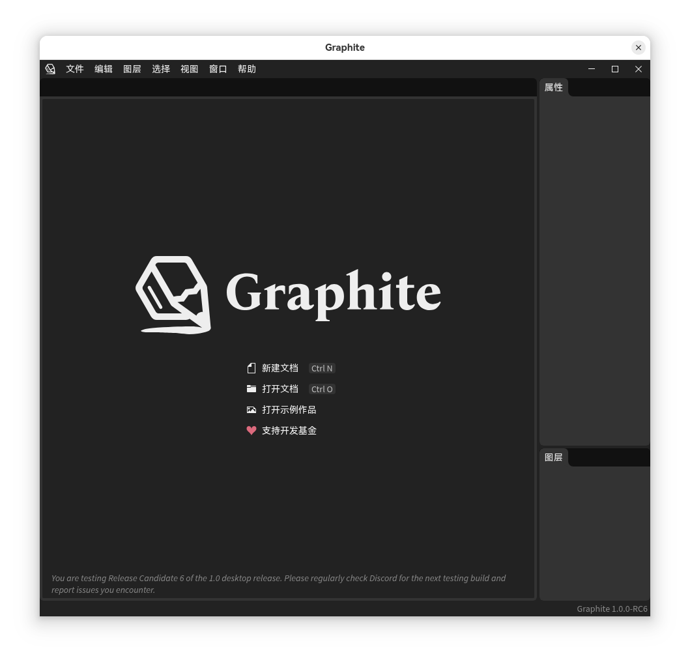

<a href="https://graphite.art/">
<picture>
<source media="(prefers-color-scheme: dark)" srcset="https://github.com/user-attachments/assets/9366c148-4405-484f-909a-9a3526eb9209">
<source media="(prefers-color-scheme: light)" srcset="https://github.com/user-attachments/assets/791508ab-bcd5-4e31-a3b9-1187cfd7a2f6">

</picture>
</a>

# Graphite 中文汉化版（Graphite-zh）

> [!IMPORTANT]
> **⚠️ 本仓库是社区个人制作的汉化版，不是 Graphite 官方项目。** 由社区个人维护，仅提供**中文界面汉化**，不提供官方支持与功能保障。完整功能、官方更新与 Bug 修复，请以上游官方仓库 [GraphiteEditor/Graphite](https://github.com/GraphiteEditor/Graphite) 为准。

> 本项目是开源矢量/光栅图形编辑器 [Graphite](https://graphite.art/) 的**中文界面汉化版**（fork 自 [GraphiteEditor/Graphite](https://github.com/GraphiteEditor/Graphite)），
> 基于上游 `c8667edac`（RC1.0）分支维护，工作分支：`zh-main`。

## ⚠️ 项目定位（重要）

**本仓库 = 界面汉化 + Agent 自动化增强，不做官方代码修复。**

- ✅ **界面汉化**：翻译 Graphite 的界面文本、整理术语对照（措辞风格参考 Blender 官方中文）、提供中文字体方案。
- 🚧 **Agent 自动化（开发中）**：为 Graphite 开放 headless CLI 接口与配套技能 `graphite-draw`，让 AI agent 能以数据方式驱动节点图绘图——**人类提供创意，agent 负责实现**。
- ✅ **官方更新，我们跟进**：上游 Graphite 有新版本，我们以 merge 方式跟进，保持与官方同步。
- ✅ **官方修复 BUG，我们才修**：上游修复了功能/逻辑 BUG，会一并合并进来。
- ❌ **不主动修复官方 BUG**：不会自行修改上游的功能逻辑、算法或架构代码。
- ⚠️ **例外：仅当 BUG 属于本仓库新增能力**（汉化词条错误、中文显示乱码/漏译、中文字体方案、汉化注入脚本缺陷，以及 CLI/自动化接口的缺陷）时，我们才修复。

想要上游官方的完整功能、提交代码或报告 BUG，请前往官方仓库：[GraphiteEditor/Graphite](https://github.com/GraphiteEditor/Graphite)。

## 汉化效果展示



## 汉化方案

Graphite 桌面版由 **Rust 后端 + Svelte 前端 + CEF 内嵌浏览器** 构成，界面文本主要由 Rust 侧生成并经由 wasm 传给前端渲染。本项目采用**注入式汉化**，不改动上游源码逻辑：

- **翻译引擎**：`frontend/public/zh/zh.js` —— 基于 `MutationObserver` 的 DOM 文本/属性替换引擎，支持精确匹配、`{0}` 模板匹配、多行文本按行翻译；未命中的文本**原样保留英文**（安全降级）。
- **翻译字典**：`frontend/public/zh/zh-dict.js` —— 约 280 条中英词条，按菜单、工具、面板、对话框、节点名等分区。
- **加载注入**：`frontend/index.html` 在应用挂载前注入脚本。
- **中文字体**：使用开源的 HarmonyOS Sans SC，随仓库分发（`desktop/assets/fonts/`），安装到用户字体目录后由 CSS 字体栈显式兜底（见下方「字体安装」）。

## 🚀 新增功能与路线图

**已实现：**

- 🇨🇳 **中文界面汉化**：注入式翻译引擎（约 280 条词条，覆盖菜单/工具/面板/对话框/常用节点），未命中词条安全降级显示英文；
- 🔤 **中文字体方案**：HarmonyOS Sans SC 随仓库分发 + CSS 字体栈显式兜底，杜绝"豆腐块"。

**开发中（Agent 自动化路线）：**

- 🖥️ **Headless CLI 接口**：基于上游 `graphene-cli` 扩展文档级命令（新建/打开/保存/导出），并开放消息级接口（增删节点、连线、设参、变换、选择）——与 GUI 完全同源，所见即所得；
- 📖 **节点说明书**：自动导出全部节点（名称/分类/参数 schema）为机器可读清单；
- 🤖 **`graphite-draw` 技能**：路由化操作手册，教 AI agent 通过 CLI 完成实际绘图（配方库：logo、图标、图表、纹样、批量生成等）。

目标工作流：**人类提供创意 → agent 将创意转译为节点图 → CLI 驱动 Graphite 实现 → 导出反馈人类评审迭代**。节点图的参数化、可 diff 特性让每次修改精确可审计——这是 GUI 操作无法给予的。

## 字体安装

桌面版首次运行前，需安装随仓库分发的中文字体，确保在未预装中文字体的系统上正常显示：

```bash
# 安装到用户字体目录（无需 root，幂等：同名跳过）
./desktop/assets/fonts/install-fonts.sh

# 验证
fc-list | grep -i "HarmonyOS Sans SC"
```

字体许可见 `desktop/assets/fonts/LICENSE-HarmonyOS.txt`。

## 构建 / 安装（Linux 桌面版）

运行以下命令构建 release 桌面版（首次全量较慢，需先装有 Rust 工具链及前端依赖）：

```bash
cargo run build desktop
```

构建产物位于 `target/release/graphite`。安装到本地：

```bash
install -m755 target/release/graphite ~/.local/lib/graphite/bin/graphite
patchelf --set-rpath '$ORIGIN/../lib/cef' ~/.local/lib/graphite/bin/graphite
```

## 与原版的关系

- 本仓库的 `master` 分支与上游 `GraphiteEditor/Graphite` 保持 1:1 镜像，汉化改动全部位于 `zh-main` 分支。
- 上游更新时：在 `zh-main` 上 `git merge upstream/master` 跟进，冲突面通常很小（仅注入脚本与字典相关文件）。

<br />

## 版权与许可

- 上游 Graphite 源码：遵循上游的 [Apache 2.0](https://github.com/GraphiteEditor/Graphite/blob/master/LICENSE.txt)（部分目录可能双许可 MIT/Apache 2.0）许可。
- 本汉化仓库：仅对汉化注入脚本、字典、字体安装脚本及文档负责，随上游许可分发。
- HarmonyOS Sans 字体：见 `desktop/assets/fonts/LICENSE-HarmonyOS.txt`，允许免费商用与随应用分发。

---

*Graphite 是 100% 由社区构建和资助的开源项目。如果你认同我们的使命，欢迎前往官方仓库通过 [donation](https://graphite.art/donate/) 支持原作者。*
